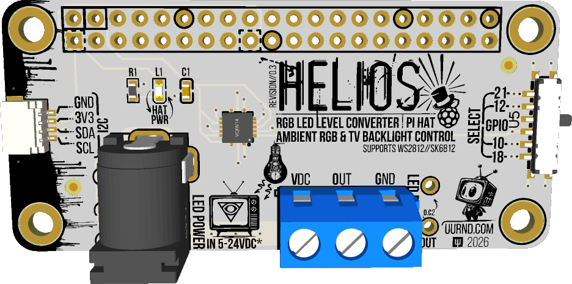

# Helios 3.3V-5V RGB(W) Level Converter Pi Hat
[![CC BY-NC-SA 4.0][cc-by-nc-sa-shield]][cc-by-nc-sa]

**The Helios RGB Pi HAt Series of level converters are designed to simply plug into your Raspberry Pi (2,3,4,5) or Raspberry Pi Zero (1,2,1W,2W) and then plug in both your RGB(W) Led strip and its power source (Example: SK6812, WS2812b) to quickly let you get setup and experimenting with amazing RGB(W) LEDs**

### Variants:
  - **HeliosRGB-Pi Hat Revision 0.3 [Single Channel]**
    - 
      - Helios RGB Level Converter Pi Hat Accepts any RGB(W) LED compatible with the 74AHCT125 chip from 5V to 24VDC so long as the RGB(W) LED supports 5V Logic Levels **(Which is most of them)**. Simply slide your RGB Strips wires into the screw terminal and plug in your LED Strip's Power into the barrel jack and you're off to the races! The board converts the Pi's 3V Logic to 5V logic that RGB LEDs like a SK6812, WS2812b or other compatible LED's need.
    Supports WS2812, SK6812 and other LEDs with input power ~5V and Logic Voltage between ~3-5v.
    
This work is licensed under a
[Creative Commons Attribution-NonCommercial-ShareAlike 4.0 International License][cc-by-nc-sa].

[cc-by-nc-sa]: http://creativecommons.org/licenses/by-nc-sa/4.0/
[cc-by-nc-sa-image]: https://licensebuttons.net/l/by-nc-sa/4.0/88x31.png
[cc-by-nc-sa-shield]: https://img.shields.io/badge/License-CC%20BY--NC--SA%204.0-lightgrey.svg
